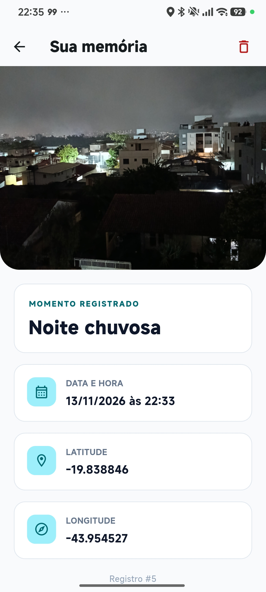

# Geodiário

Aplicativo mobile desenvolvido em Flutter para registrar momentos com
título, fotografia, data, horário e localização geográfica.

Os registros são armazenados localmente em SQLite. As fotografias são
copiadas para o diretório de documentos do aplicativo, enquanto o banco
armazena o caminho de cada arquivo.

## Informações acadêmicas

- Autor: Gustavo Faria de Paula Reis
- Curso: Ciência da Computação
- Disciplina: Desenvolvimento para Dispositivos Móveis

## Funcionalidades

- Cadastro de registros com título.
- Captura de fotografias pela câmera.
- Armazenamento das fotos no diretório do aplicativo.
- Obtenção de latitude e longitude.
- Registro automático de data e horário.
- Persistência dos dados em SQLite.
- Listagem com miniatura, título, data e coordenadas.
- Tela de detalhes com foto ampliada e informações do registro.
- Confirmação antes da exclusão.
- Exclusão do arquivo da foto e do registro no banco.
- Atualização da listagem após cadastro ou exclusão.
- Interface com Material 3 e transição Hero entre fotos.

## Tecnologias e pacotes

| Tecnologia ou pacote | Utilização |
|---|---|
| Flutter e Dart | Desenvolvimento do aplicativo |
| material_ui | Componentes da interface Material |
| sqflite | Banco de dados SQLite local |
| path | Composição dos caminhos de arquivos e do banco |
| path_provider | Acesso ao diretório de documentos do aplicativo |
| image_picker | Captura de imagens pela câmera |
| geolocator | Permissões e obtenção da localização |
| cupertino_icons | Pacote de ícones incluído no projeto inicial |

As versões das dependências estão declaradas no `pubspec.yaml`.
O arquivo `pubspec.lock` registra as versões resolvidas no projeto.

## Organização do código

```text
lib/
├── db/
│   └── database_helper.dart
├── models/
│   └── registro.dart
├── screens/
│   ├── detalhes_registro_screen.dart
│   ├── home_screen.dart
│   └── novo_registro_screen.dart
└── main.dart
```

### Responsabilidades

- `main.dart`: inicialização do aplicativo e configuração do tema.
- `registro.dart`: modelo de dados e conversões `toMap()` e `fromMap()`.
- `database_helper.dart`: abertura do banco, criação da tabela,
  inserção, consulta e exclusão.
- `home_screen.dart`: listagem e navegação para cadastro e detalhes.
- `novo_registro_screen.dart`: título, câmera, GPS e salvamento.
- `detalhes_registro_screen.dart`: exibição dos dados e exclusão.

## Banco de dados SQLite

- Arquivo do banco: `geodiario.db`
- Versão do banco: `1`
- Tabela: `registros`

### Estrutura da tabela

| Coluna | Tipo SQLite | Restrições / finalidade |
|---|---|---|
| id | INTEGER | PRIMARY KEY AUTOINCREMENT |
| titulo | TEXT | NOT NULL |
| caminhoImagem | TEXT | NOT NULL |
| dataHora | TEXT | NOT NULL |
| latitude | REAL | NOT NULL |
| longitude | REAL | NOT NULL |

### SQL de criação

```sql
CREATE TABLE registros (
  id INTEGER PRIMARY KEY AUTOINCREMENT,
  titulo TEXT NOT NULL,
  caminhoImagem TEXT NOT NULL,
  dataHora TEXT NOT NULL,
  latitude REAL NOT NULL,
  longitude REAL NOT NULL
);
```

### Operações implementadas

- `inserirRegistro(Registro registro)`
- `listarRegistros()`
- `deletarRegistro(int id)`

### Tratamento dos dados

O identificador é gerado pelo SQLite na inserção.

A data e o horário são armazenados como texto usando:

```dart
DateTime.now().toIso8601String()
```

A apresentação amigável da data utiliza `DateTime.parse()` somente
na camada visual, sem modificar o valor armazenado.

As fotografias não são armazenadas como BLOB no banco. A coluna
`caminhoImagem` guarda o caminho do arquivo no diretório do aplicativo.

A latitude e a longitude são armazenadas como valores numéricos.

## Permissões Android

Declaradas em `android/app/src/main/AndroidManifest.xml`:

```xml
<uses-permission android:name="android.permission.CAMERA" />
<uses-permission android:name="android.permission.ACCESS_FINE_LOCATION" />
<uses-permission android:name="android.permission.ACCESS_COARSE_LOCATION" />
```

O usuário deve autorizar os acessos solicitados e manter o serviço
de localização do celular ativado para obter as coordenadas.

## Como executar

### Pré-requisitos

- Flutter SDK instalado e configurado.
- Android SDK configurado.
- Dispositivo Android com depuração USB ativada ou emulador
  com suporte aos recursos utilizados.

### Passos

1. Clone este repositório.
2. Abra o terminal na raiz do projeto.
3. Instale as dependências:

```bash
flutter pub get
```

4. Confira a análise do código:

```bash
flutter analyze
```

5. Consulte os dispositivos disponíveis:

```bash
flutter devices
```

6. Execute no dispositivo Android desejado:

```bash
flutter run -d ID_DO_DISPOSITIVO
```

Substitua `ID_DO_DISPOSITIVO` pelo identificador apresentado
por `flutter devices`.

## Capturas de tela

### Tela inicial

Listagem dos registros com foto, título, data e coordenadas.


### Cadastro

Captura da foto, preenchimento do título e obtenção da localização.


### Detalhes

Foto ampliada e informações do registro.



## Checklist de testes manuais

Marque os itens somente depois de executar os testes.

- [X] Cadastro completo com título, foto e localização.
- [X] Validação de título obrigatório.
- [X] Validação de foto obrigatória.
- [X] Validação de localização obrigatória.
- [X] Exibição da foto e dos dados na tela de detalhes.
- [X] Exibição da data no formato DD/MM/AAAA às HH:mm.
- [X] Cancelamento da exclusão sem remover o registro.
- [X] Exclusão confirmada com remoção do item da lista.
- [X] Remoção do arquivo da foto pelo fluxo de exclusão.
- [X] Atualização da lista após novo cadastro.
- [X] Permanência dos registros e fotos após fechar e reabrir o app.
- [X] Análise com flutter analyze sem problemas.

## Observações

- Os dados são armazenados localmente; não há sincronização em nuvem.
- Câmera e localização dependem das permissões do usuário.
- A exclusão da foto e a exclusão no SQLite são operações separadas.
- As capturas de tela devem utilizar dados apropriados para publicação.